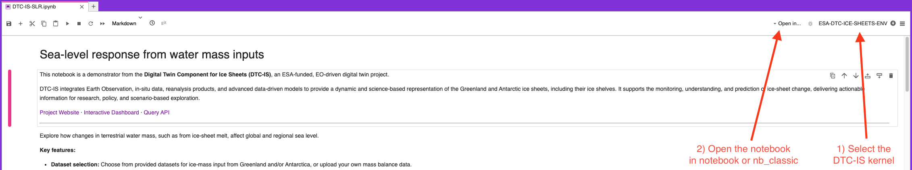

# Digital Twin Component for Ice Sheets (DTC-IS) Jupyter Notebook demonstrators

This folder contains notebook demonstrators for the [Digital Twin Component for Ice Sheets (DTC-IS)](https://dtc-ice-sheets.org/), an ESA-funded, EO-driven digital twin project.

The notebooks access the system's functionality through the [DTC-IS Query API](https://query.dtc-ice-sheets.org/docs), using its [Python client](https://pypi.org/project/dtc-query-client/).

For a more interactive way of exploring the system, please visit the twin's [dashboard](https://dashboards.dtc-ice-sheets.org/).

If you have any questions or encounter any issues while using the notebooks, please get in touch with the DTC-IS team at support@dtc-ice-sheets.org.

## Getting started

The DTC-IS notebooks have some dependencies that are additional to those installed on Insula's default kernel. We recommend that users create a virtual environment rather than using their default environment. Scripts have been provided to facilitate this.

### Finding the notebooks within Insula code

In finding this readme, the odds are that you have already found the notebooks! For completeness, the DTC-IS notebooks can be found at `~/platform-lab/ESA-DTC/DTC_ICE_SHEETS` from within your Insula code environment.

### Creating your virtual environment

We have created bash scripts for the convenient creation and management of the environment required to run these notebooks. To run these scripts This script Run the following commands in the Insula code terminal to execute the scripts (select `File->New->Terminal` in Insula to access a terminal instance):

``` bash
bash ~/platform-lab/ESA-DTC/DTC_ICE_SHEETS/setup-scripts/create-virtual-environment.sh
```

### Removing the virtual environment

A script for deleting the environment and its registered Jupyter kernel is also provided.

``` bash
bash ~/platform-lab/ESA-DTC/DTC_ICE_SHEETS/setup-scripts/remove-virtual-environment.sh
```

### Troubleshooting

If the environment has become polluted during development, or there are any dependency issues. The first thing to try is [deleting](#removing-the-virtual-environment) the existing environment and [re-installing](#creating-your-virtual-environment) it again from scratch.

### Running the notebooks

Once you have found the notebooks and installed the environment, you can run any of the notebooks with the following steps:

1. Open the notebook in Insula code.
1. Select the kernel `esa_dtc_ice_sheets_env` created in [this section](#creating-your-virtual-environment) - see (1) in [the screenshot](#running-the-notebook-screenshot).
1. Open the notebook by selecting your preferred notebook type - see (2) in [the screenshot](#running-the-notebook-screenshot).
1. Have your DTC-IS authentication token at the ready (see [this section](#running-the-notebook---authentication)) 
1. Run through the notebook cell by cell - providing inputs and selections when prompted to do so.

> **_NOTE:_**  Some cells in these notebooks trigger externally hosted workflows to derive the results and may take a while to complete. Please allow each cell to complete before moving on to the next one. A spinning animation is shown at the bottom of a cell (or next to the button you clicked) for as long as it is still working. Workflow results are cached, so subsequent runs of each step should complete faster.

#### Running the notebook screenshot



#### Running the notebook - authentication

Each notebook requires a DTC-IS API token for authentication, and will prompt you to enter yours. You can obtain your token by navigating [here](https://query.dtc-ice-sheets.org/auth/get-token).

## The notebooks

Each notebook contains a comprehensive description of its purpose and methodology. A short overview is provided below for orientation purposes.

1. DTC-IS-SLR.ipynb - Explore how changes in terrestrial water mass, such as those resulting from ice-sheet melt, affect global and regional sea level.
1. DTC-IS-SLR-PROJ.ipynb - Use mass balance projections based on different ice sheet modelling datasets to play out future sea levels at both global and regional locations.
